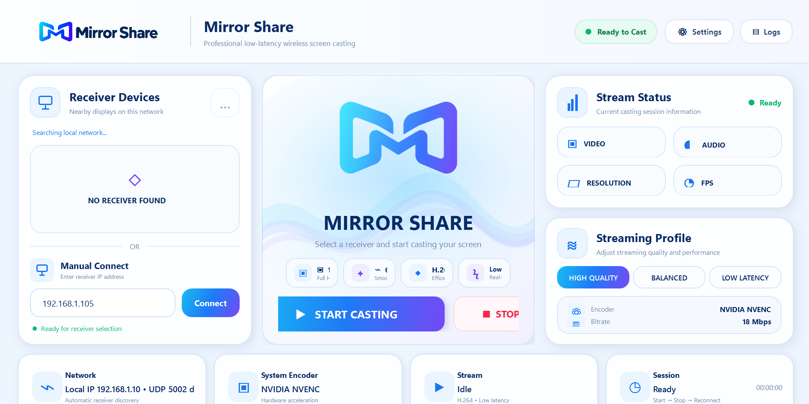

<div align="center">


# Mirror Share

### Your Windows screen. Your Android TV. One local network.

A Windows sender and Android TV receiver for local-network screen sharing, with device discovery, streaming profiles, and audio support.

[](https://github.com/avinasalingam23-blip/MirrorShare/releases/tag/v1.0.0)


[](https://github.com/avinasalingam23-blip/MirrorShare/actions/workflows/build-android.yml)

**[Download for Windows](https://github.com/avinasalingam23-blip/MirrorShare/releases/download/v1.0.0/MirrorShare-Setup.msi)** · **[Download for Android TV](https://github.com/avinasalingam23-blip/MirrorShare/releases/download/v1.0.0/MirrorShare-TV-test.apk)** · **[Release notes](https://github.com/avinasalingam23-blip/MirrorShare/releases/tag/v1.0.0)**

</div>

## Overview

Mirror Share captures a selected Windows display, encodes it as H.264 using FFmpeg, and sends it to the Android TV receiver over a local network. The sender can discover receivers automatically or connect using a TV's IP address.

**Maintained by [Avinasalingam](https://github.com/avinasalingam23-blip).**

## Windows sender



*The Windows sender in its idle state. This screenshot shows the interface; an active casting session is not shown.*

## Features

- **Receiver discovery:** find TVs running Mirror Share TV on the same network, or enter an IP address manually.
- **Streaming profiles:** choose High Quality, Balanced, or Low Latency.
- **Encoder fallback:** attempts NVIDIA NVENC, Intel Quick Sync, AMD AMF, and CPU x264 where available.
- **Audio sharing:** capture system audio through a separately installed and configured VB-Audio Virtual Cable.
- **Session controls:** start and stop casting, inspect stream status, and open settings or logs.
- **Source and packaging:** C# WPF sender, Kotlin TV receiver, WiX MSI configuration, and an online Android APK build workflow.

### Configured streaming profiles

| Profile | Resolution | Target frame rate |
| --- | --- | --- |
| High Quality | 1920 × 1080 | 60 FPS |
| Balanced | 1920 × 1080 | 30 FPS |
| Low Latency | 1280 × 720 | 60 FPS |

These are encoder targets configured in the source. Actual frame rate and latency depend on the laptop, TV, and network; measured results for the current release have not been recorded.

## Downloads

| File | Device | Details |
| --- | --- | --- |
| [MirrorShare-Setup.msi](https://github.com/avinasalingam23-blip/MirrorShare/releases/download/v1.0.0/MirrorShare-Setup.msi) | Windows x64 laptop | Sender installer with the .NET runtime and FFmpeg bundled |
| [MirrorShare-TV-test.apk](https://github.com/avinasalingam23-blip/MirrorShare/releases/download/v1.0.0/MirrorShare-TV-test.apk) | Android TV | Debug-signed receiver APK, app version 1.0.0 |

**Current release: [v1.0.0 — pre-release](https://github.com/avinasalingam23-blip/MirrorShare/releases/tag/v1.0.0).** The Windows installer has been built and the updated interface checked. The TV APK has been built and its signature verified. End-to-end casting with this new pair of builds is awaiting testing.

The SDKs below are needed only for development. You do not need Android Studio or the .NET SDK just to install these downloads.

## Quick start

1. Install **MirrorShare-Setup.msi** on your Windows laptop.
2. Transfer **MirrorShare-TV-test.apk** to your Android TV and install it. Allow installation from your chosen file-transfer app if the TV requests it.
3. Connect both devices to the same local network.
4. Open **Mirror Share TV** on the TV. Close the old receiver if it is still running.
5. Open **Mirror Share** on Windows. Select a discovered TV, or use **Manual Connect** with the TV's local IP address.
6. Choose a streaming profile and click **Start Casting**. Use **Stop** to end the session.

The TV package is `com.mirrorshare.receiver`. It installs separately from the earlier receiver; open **Mirror Share TV** when testing this release.

### Audio setup

The MSI does not install VB-Audio Virtual Cable. Install or retain that driver separately, then set Windows playback to **CABLE Input**. Mirror Share captures **CABLE Output** through FFmpeg and sends it to the TV.

If that audio device is unavailable, the sender can continue video streaming while reporting audio as unavailable.

## Technology and network

| Component | Implementation |
| --- | --- |
| Windows sender | C# · WPF · .NET 10 |
| TV receiver | Kotlin · Android SDK 36 · minimum API 23 |
| Video | FFmpeg · H.264 over TCP 5000 |
| Audio | Stereo 44.1 kHz PCM over TCP 5001 |
| Discovery | UDP 5002 |
| Windows packaging | WiX Toolset 5.0.2 |
| Android build | Gradle 8.11.1 · AGP 8.10.1 · Kotlin 2.2.21 |
| Online build | GitHub Actions |

Use a trusted local network. The current media transport is unencrypted.

## Build from source

### Windows sender and MSI

You need Windows x64 and the **.NET 10 SDK**.

1. Clone this repository.
2. Place a Windows x64 `ffmpeg.exe` in `WindowsSender/`. It must support desktop capture (`gdigrab`), DirectShow audio (`dshow`), and H.264 encoding (`libx264`). The executable is included in the MSI and original source bundle but excluded from Git because of its size.
3. Run this command from the repository root:

```cmd
Build-MirrorShare.cmd -Target Windows
```

After a successful build, `artifacts/` contains the MSI, a portable Windows ZIP, checksums, and a build log. The first build needs internet access to restore dependencies.

### Android TV APK using GitHub Actions

Open **Actions → Build Mirror Share TV APK → Run workflow** in your own copy of this repository. After a successful run, download the **MirrorShare-TV-test** artifact and extract the APK.

The workflow builds the updated receiver source and verifies the APK signature. It produces a **debug-signed test APK**. Each clean runner generates a new debug key, so a later test APK may require uninstalling the previous test build before installation.

### Android TV release APK on Windows

For a release-signed local build, install Android SDK Platform **36**, Build Tools **35.0.0**, Android SDK Command-line Tools, and **JDK 17 or 21**. Android Studio can install the SDK components.

```cmd
Build-MirrorShare.cmd -Target Android
```

The script creates or reuses a signing key under `%LOCALAPPDATA%\Mirror Share\Signing` and writes `artifacts/MirrorShare-TV.apk`. Its saved password uses Windows DPAPI and is tied to the current Windows account and machine.

To use your own key, configure `MIRRORSHARE_KEYSTORE_PATH`, `MIRRORSHARE_KEYSTORE_PASSWORD`, and optionally `MIRRORSHARE_KEY_ALIAS`. Keep signing credentials private and retain the key for future updates.

## Troubleshooting

| Symptom | What to check |
| --- | --- |
| No receiver found | Open Mirror Share TV, confirm both devices share the same LAN, and try Manual Connect. Guest Wi-Fi or client isolation may block device-to-device traffic. |
| Video connection fails | Confirm the TV's IP, close the earlier receiver, and check local firewall access to TCP 5000. |
| Video works without audio | Verify VB-CABLE installation, Windows playback routing to CABLE Input, and access to TCP 5001. |
| A later test APK will not install | It may use a different debug key. Uninstall the earlier Mirror Share TV test build, then install the new APK. |
| Windows build reports missing FFmpeg | Place `ffmpeg.exe` in `WindowsSender/` before building. |
| Build fails | Read the first error in the command output or `artifacts/Build.log`. |

## Repository layout

| Path | Contents |
| --- | --- |
| `WindowsSender/` | Windows app source and assets |
| `AndroidTVReceiver/` | TV app source, resources, and Gradle wrapper |
| `Packaging/` | WiX MSI project |
| `Branding/` | Mirror Share wordmark, symbol, and Windows icon |
| `assets/` | README screenshots |
| `.github/workflows/build-android.yml` | Online TV APK build |
| `Build-MirrorShare.cmd` / `Build-MirrorShare.ps1` | Local build commands |
| [Validation notes](docs/VALIDATION.md) | Completed checks and pending device tests |

## Project status

The pre-release is available for download. Next steps are testing discovery, video, audio, and reconnection on the new builds; recording hardware and performance results; and configuring permanent Android release signing.

Bug reports can be submitted through [GitHub Issues](https://github.com/avinasalingam23-blip/MirrorShare/issues). Include the app version, Windows/TV details, reproduction steps, and relevant logs.
